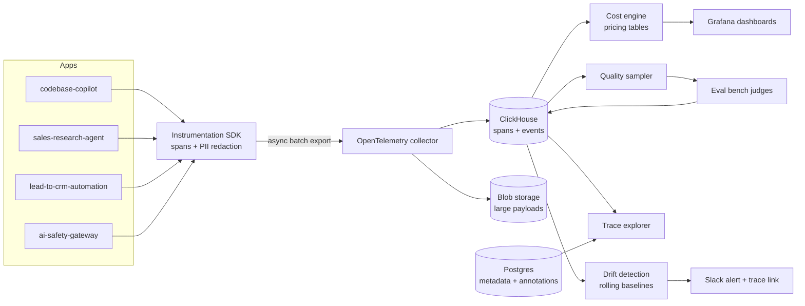

# 📡 AI Production Monitor

**Tracing, cost attribution, and quality-drift alerting for LLM systems, because a `200 OK` can still be a wrong answer.**

  

> 🚧 **This project is in the design phase.** This README documents the problem, planned architecture, and tradeoffs. Progress is tracked in the [Roadmap](#-roadmap), and measured results will be added to the [Design Log](#-design-log) as each phase ships.

---

## 📌 The Problem

Traditional monitoring asks: *did the service respond, and how fast?*

LLM systems fail differently. The call succeeds, latency looks fine, and yet:
- The answer is wrong or ungrounded
- A prompt change quietly made quality worse
- One feature now costs 3× more than last week
- One user request fanned out into 12 model calls and nobody can see why

Standard APM dashboards stay green through all of it.

## 💡 The Solution

An observability layer built for LLM applications: **nested tracing** across model and tool calls, **token and cost attribution**, **online quality scoring** of sampled production traffic (using the eval bench's judges), and **drift alerts** that link straight to the offending trace.

### Planned capabilities
- Drop-in SDK (decorator / context manager) emitting OpenTelemetry-compatible spans
- Session → trace → span tree viewer with inputs and outputs
- Cost dashboards sliced by feature, user, tenant, and prompt version
- Online quality sampling scored by the eval bench judges
- Drift detection on input length, topics, refusal rate, and quality
- Slack alerts with deep links to example traces
- PII redaction at the SDK boundary

---

## 🏗️ Architecture



### Flow
1. **Instrument** – apps wrap LLM and tool calls with the SDK; each span records model, prompt version, tokens, latency, cost, and parent span.
2. **Redact** – PII is scrubbed at the SDK before anything leaves the process.
3. **Export** – spans are batched and exported asynchronously, never blocking the request.
4. **Store** – high-volume spans in ClickHouse; oversized payloads in blob storage with pointers; errors always keep full payloads.
5. **Attribute** – pricing tables turn token counts into dollars per feature, tenant, and prompt version.
6. **Score** – a sample of live traffic is graded by the same judges used offline.
7. **Detect** – rolling statistical baselines flag sustained shifts in quality, cost, or input distribution.
8. **Alert** – Slack message with a deep link to example traces.

---

## 🧰 Tech Stack (planned)

| Layer | Choice | Why |
|---|---|---|
| Tracing | OpenTelemetry SDK + GenAI semantic conventions | Standard field names, no vendor lock-in |
| Span storage | ClickHouse | Built for high-volume event analytics |
| Metadata | Postgres | Annotations, prompt versions, shared with other projects |
| Dashboards | Grafana + custom trace explorer | Ops views + prompt-level debugging |
| Alerting | Statistical baselines → Slack | Fewer, more meaningful alerts |
| Prior art studied | Langfuse, Phoenix, Helicone | Learn their trace models before designing mine |

---

## ⚖️ Key Design Decisions & Tradeoffs

| Decision | Chosen | Alternative | Tradeoff |
|---|---|---|---|
| Span format | OpenTelemetry GenAI conventions | Custom schema | Less freedom, but compatible with existing tools |
| Storage | ClickHouse + Postgres | Postgres only | Two systems to run, but spans scale separately from metadata |
| Payload logging | Sample + truncate, full payloads on errors | Log everything | Some context lost on healthy calls; storage stays affordable |
| Export | Async batched | Synchronous | Small data-loss risk on crash; zero added request latency |
| Alerting | Rolling baselines + sustained deviation | Fixed thresholds | Slower to fire, far less alert fatigue |
| PII handling | Redact at SDK | Redact in storage | Harder to debug some cases, but raw PII never leaves the app |

---

## 🧗 Hard Problems I'm Planning For

- **Payload volume** – full prompts and completions are huge. → Sampling, truncation with blob pointers, always keep errors.
- **PII in traces** – prompts contain customer data. → Redact before export; per-field retention rules.
- **Overhead** – instrumentation must be invisible. → Batch, compress, export off the request path.
- **Alert fatigue** – LLM metrics are noisy. → Statistical process control, require sustained deviation.
- **Retries double-counting cost** – → Model retry relationships explicitly in spans.

---

## 📏 How I'll Measure It

All values are **targets**.

| Metric | What it tells me | Target |
|---|---|---|
| Instrumentation overhead | Added P99 latency | Single-digit milliseconds |
| Trace completeness | % of calls with an unbroken span tree | ≥ 99% |
| Time to diagnose | Seeded failure found using only the dashboard | Minutes, not hours |
| Alert precision | % of alerts that were real problems | Reported; tuned upward over time |

---

## 🗺️ Roadmap

- [ ] **Phase 1 – Capture:** SDK logs every LLM call in the RAG copilot with tokens and latency
- [ ] **Phase 2 – Trace tree:** nested span viewer; any request reconstructable end to end
- [ ] **Phase 3 – Cost:** attribution + dashboards by feature and prompt version
- [ ] **Phase 4 – Quality:** online sampling scored by eval bench judges; production quality time series
- [ ] **Phase 5 – Alerting:** drift detection + Slack alerts linking to example traces

**Stretch:** auto-clustering of similar failing traces · replay a stored trace against a new prompt and diff · per-tenant budgets that fall back to a cheaper model

### Non-goals (for now)
- Replacing general-purpose APM for non-LLM services
- Multi-region / HA deployment
- A hosted product

---

## 📁 Planned Repo Structure

```
ai-production-monitor/
├── sdk/              # decorators, span model, redaction, async exporter
├── collector/        # OTel collector config
├── storage/          # ClickHouse schemas, Postgres models
├── cost/             # pricing tables + attribution jobs
├── quality/          # sampler + judge integration
├── drift/            # baselines, detectors, alert routing
├── explorer/         # trace tree UI
├── dashboards/       # Grafana JSON
├── docs/decisions/
└── tests/
```

---

## 🔗 Part of a Larger System

This is **layer 5 (Observability)**. It instruments every other project.

| Layer | Repo |
|---|---|
| Retrieval | [codebase-copilot](https://github.com/khushi0101/codebase-copilot) |
| Evals | [llm-eval-bench](https://github.com/khushi0101/llm-eval-bench) – its judges score live traffic here |
| Agents | [sales-research-agent](https://github.com/khushi0101/sales-research-agent) |
| Automation | [lead-to-crm-automation](https://github.com/khushi0101/lead-to-crm-automation) |
| Observability | **ai-production-monitor** (you are here) |
| Guardrails | [ai-safety-gateway](https://github.com/khushi0101/ai-safety-gateway) – its decision log feeds in here |

---

## 🎬 Planned Demo

Seed a regression by swapping in a worse prompt version. Watch the quality line bend, the Slack alert fire, and the deep link land on the exact trace where the model answered without retrieved context. Then open the cost dashboard and name the most expensive feature.

---

## 🚀 Getting Started

*Coming with Phase 1.*

---

## 📓 Design Log

| Date | Change | Metric | Before → After | Decision |
|---|---|---|---|---|
| – | – | – | – | – |

---

## 👩‍💻 Author

**Khushi Agrawal** · [GitHub](https://github.com/khushi0101) · [LinkedIn](https://linkedin.com/in/khushi--agrawal)
